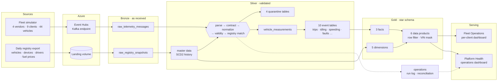
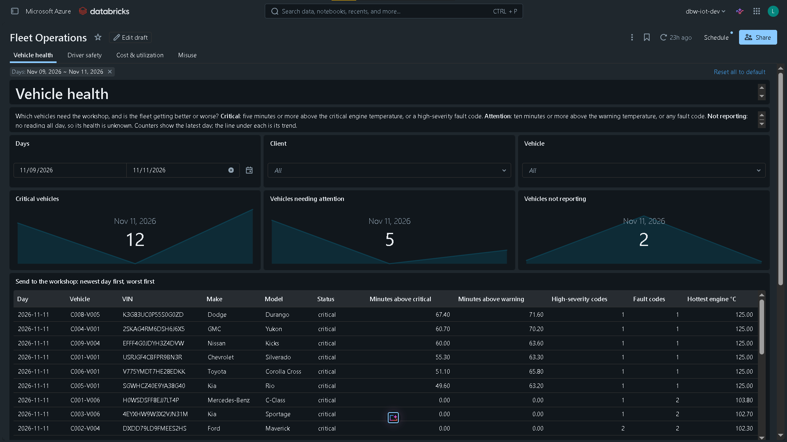
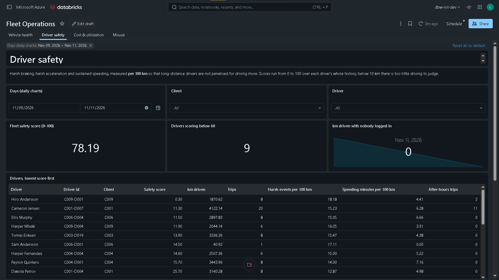
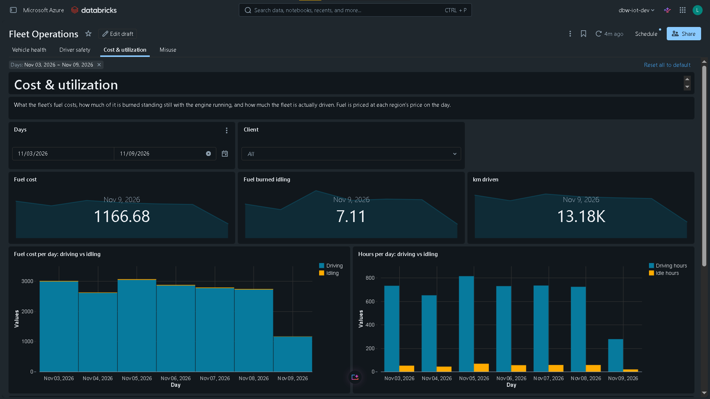
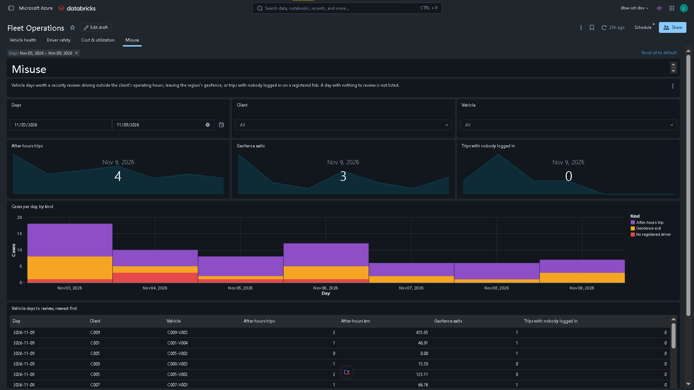
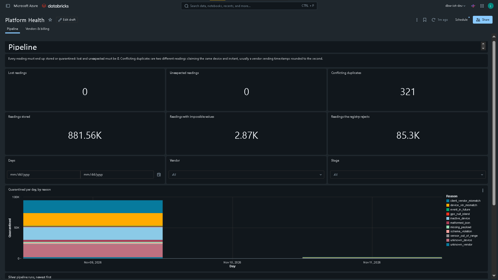
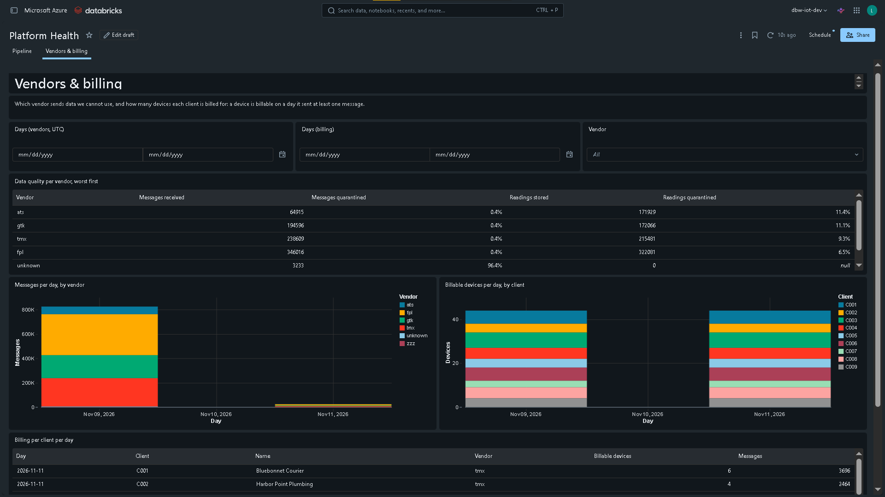
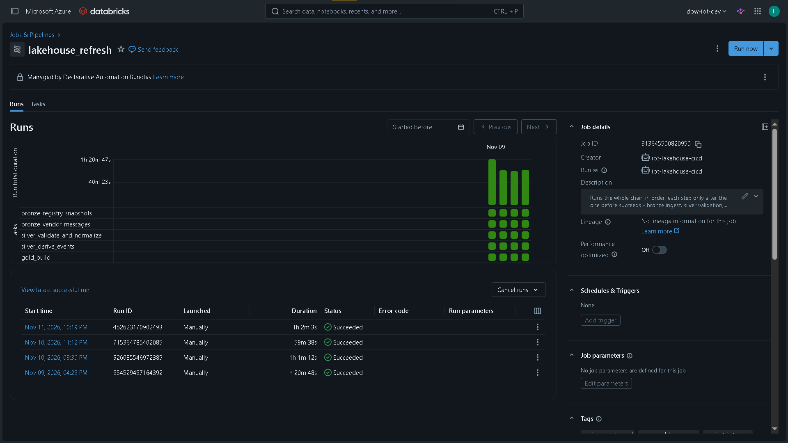
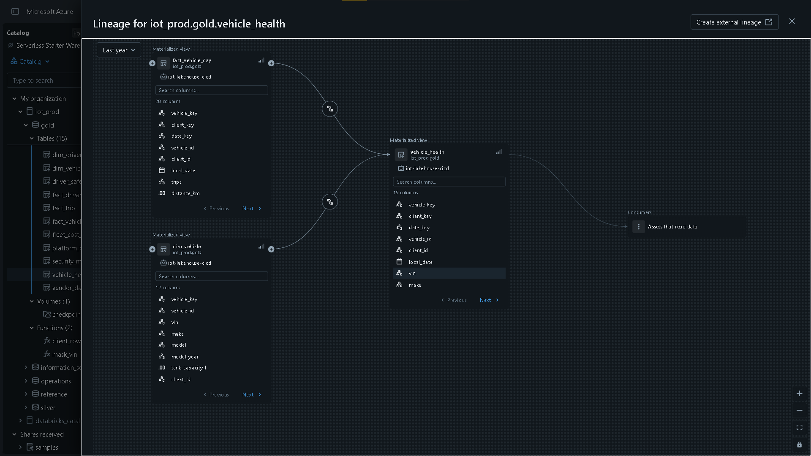
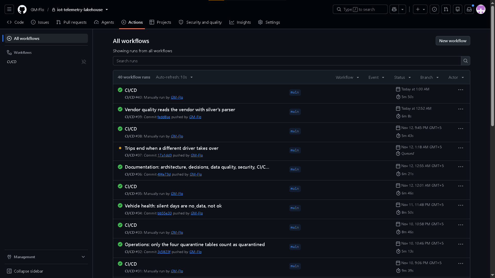

# Real-Time IoT Vehicle Telemetry Lakehouse

**Four telematics vendors, four incompatible formats, one trustworthy fleet platform.**
Azure Event Hubs streams vehicle telemetry into a Databricks medallion lakehouse that
validates every reading against its vendor's contract and the fleet registry, quarantines
what it cannot trust, proves nothing was lost, and serves row-secured dashboards to each
fleet company.


---

## The problem

A fleet platform buys tracking devices from several telematics vendors. Each vendor sends
data its own way: one sends flat metric JSON, one sends imperial units and epoch
milliseconds, one sends nested objects with timestamps that carry no time zone, and one
batches several readings into a single message. Devices also lie: they report the wrong
VIN, the wrong account, keep transmitting after being retired, or start sending before
anyone registered them. Vendors change their format without warning.

The platform has to turn all of that into one clean dataset and answer five questions for
every fleet company:

| # | Question | Answered by |
|---|---|---|
| 1 | Which vehicles need the workshop? | `gold.vehicle_health` |
| 2 | Which drivers drive dangerously? | `gold.driver_safety` |
| 3 | Where is fuel money being wasted? | `gold.fleet_cost_utilization` |
| 4 | Is any vehicle being misused? | `gold.security_misuse` |
| 5 | What do we bill, and which vendor sends bad data? | `gold.platform_billing`, `gold.vendor_data_quality` |

## Architecture



Everything is code: Terraform builds the Azure platform, a Databricks Asset Bundle
defines every job, pipeline and dashboard, and GitHub Actions tests, validates and deploys
it. Full walkthrough: [docs/ARCHITECTURE.md](docs/ARCHITECTURE.md).

## Results from the production run

A seven-day backfill plus live data for 9 fleet companies, 44 vehicles and 45 transmitting
devices, all four vendors.

| | |
|---|---|
| **Messages ingested** | 849,138 |
| **Readings expected** (bronze recounted independently) | 970,015 |
| **Readings stored** | 881,557 |
| **Readings quarantined** with a reason | 88,173 (impossible values 2,874 · rejected by the registry 85,299) |
| **Messages quarantined before parsing a reading** | 8,420 (unparseable 6,692 · contract violations 1,728) |
| **Lost readings** | **0** |
| **Invented readings** | **0** |
| **Conflicting duplicates found** | 321 (two readings claiming the same device and second) |
| **Test suite** | 416 tests, fast set on every push, full suite on `main` |

What the platform caught on its own, with no code written for those cases:

- **Every planted integration fault**, each about one device-week of readings, quarantined
  with the exact reason: a retired device still transmitting, a device reporting the wrong
  VIN, a device reporting another client's account, and a device nobody had registered.
- **A vendor format change mid-stream.** FleetPulse firmware 2 moved to metric units,
  nested objects and ISO timestamps on 5 of 16 devices. Silver read both versions side by
  side from a mapping table, without a redeploy.
- **A late registration.** Once the missing device was registered, its new readings flowed
  straight into the clean data, and within an hour the vehicle showed up as critical. Its
  20,852 earlier readings stayed in quarantine, counted and recoverable.
- **Devices whose clocks run behind**, found by the odometer, which can only go up, and left
  out of every trip and event.

How each check works and the numbers behind it: [docs/DATA_QUALITY.md](docs/DATA_QUALITY.md).

## Screenshots

| | |
|---|---|
|  **Fleet Operations · Vehicle health.** Critical, attention and not-reporting vehicles per day; the workshop list worst-first. |  **Fleet Operations · Driver safety.** Scores per 100 km, recomputed from totals, never averaged from daily scores. |
|  **Fleet Operations · Cost & utilization.** Fuel priced per region per day, driving versus idling. |  **Fleet Operations · Misuse.** After-hours trips, geofence exits, trips with nobody logged in. |
|  **Platform Health · Pipeline.** Reconciliation counters, quarantine by reason, the run log. |  **Platform Health · Vendors & billing.** Data quality per vendor, billable devices per client. |
|  **The refresh job.** Five steps, each only after the one before succeeds. |  **The silver pipeline graph**, drawn by Lakeflow from the code. |
|  **Unity Catalog lineage** from bronze to a data product. |  **CI/CD.** Lint, tests, bundle validation, then the gated prod deploy. |

More evidence, including the reconciliation and late-registration queries:
[docs/EVIDENCE.md](docs/EVIDENCE.md).

## Highlights

- **Contracts for every vendor format.** Each message is checked against its vendor's JSON
  Schema before any field is read. Supporting a new contract version is a row in
  `reference/vendor_contract_versions.csv` and rows in `vendor_field_mappings.csv`.
- **One streaming query shape for every vendor.** Normalization is a single stream where
  every field is a `CASE` on the contract, so adding a vendor never changes the number of
  streaming sources, which would break every checkpoint downstream.
- **The registry decides identity, never the device.** Each reading is matched against
  device assignments as they were on the reading's date. A passing reading takes vehicle,
  client and driver from the registry.
- **Nothing lost, nothing invented, and proven.** An independent batch recount of bronze is
  compared by identity, `(device_id, event_ts)`, with every stored and quarantined reading.
  Pipeline expectations fail loudly if either number leaves 0.
- **Deduplication on the natural key.** AUTO CDC keeps one row per device and instant:
  Event Hubs redeliveries and vendor re-sends collapse, and the latest copy wins.
- **Row-level security as a product feature.** Unity Catalog row filters show each fleet
  manager only their own company, and a column mask hides VINs from everyone but platform
  admins. The client-facing dashboard runs every query as the viewer.
- **Production is read-only for people.** A service principal deploys and owns everything in
  prod; humans can view it and change it only through git and the CI/CD pipeline.
- **Dashboards as code.** Layouts are Python and queries are SQL files, generated into
  Lakeview definitions and deployed with the bundle. CI fails if the generated files drift.

## Tech stack

| Area | Tools |
|---|---|
| Ingestion | Azure Event Hubs (Kafka endpoint), Spark Structured Streaming, Auto Loader |
| Processing | Databricks Lakeflow Declarative Pipelines, expectations, AUTO CDC (SCD1 and SCD2) |
| Storage and governance | Delta Lake, ADLS Gen2, Unity Catalog (row filters, column masks, lineage) |
| Serving | Databricks SQL, Lakeview dashboards |
| Infrastructure | Terraform (azurerm), Databricks Asset Bundles |
| CI/CD | GitHub Actions, OAuth machine-to-machine with a service principal |
| Code and tests | Python 3.11, PySpark 3.5, JSON Schema, pytest, ruff |

## Repository layout

```
├── infra/                 Terraform: resource group, ADLS Gen2, Event Hubs, Databricks, budget
├── databricks.yml         Bundle: variables and the dev and prod targets
├── resources/             Jobs, pipelines and dashboards, as bundle resources
├── notebooks/             Bronze ingest and one-time environment setup
├── pipelines/             Lakeflow pipeline definitions: silver and gold
├── src/iot/               All transformation logic, as pure, tested functions
├── src/producer/          The fleet simulator that plays four vendors
├── contracts/             JSON Schema contract per vendor format version
├── reference/             Mappings, validity limits, thresholds, fault codes
├── dashboards/            Dashboard SQL and the generated Lakeview files
├── tests/                 416 pytest tests against local Spark
├── docs/                  Architecture, decisions, data quality, security, operations
└── .github/workflows/     CI/CD
```

Notebooks and pipeline files stay thin: they read, call a function from `src/iot/`, and
write. Every rule lives in a function that the test suite runs against small DataFrames
on a laptop.

## Running it

Prerequisites: an Azure subscription, Terraform, the Databricks CLI, and Python 3.11.

```bash
# 1. Platform
cd infra && cp terraform.tfvars.example terraform.tfvars   # fill in your values
terraform init && terraform apply

# 2. Code and the dev environment
pip install -r requirements-dev.txt
pytest -m "not slow"
databricks bundle deploy

# 3. Bootstrap an environment's catalog and security (once per environment;
#    the very first one also needs storage_account=<name from terraform output>)
databricks bundle run setup_environment --params catalog=iot_dev

# 4. Data: registry, then telemetry
python src/producer/produce.py --env dev --export-registry fleet_registry_$(date +%F).json
python src/producer/produce.py --env dev --mode backfill --backfill-hours 24

# 5. Process everything
databricks bundle run lakehouse_refresh
```

Production is deployed only by CI/CD. The full runbook, including secrets, the service
principal and teardown: [docs/OPERATIONS.md](docs/OPERATIONS.md).

## Documentation

| Document | What it covers |
|---|---|
| [ARCHITECTURE.md](docs/ARCHITECTURE.md) | Every layer and table, and how data moves between them |
| [DECISIONS.md](docs/DECISIONS.md) | Architecture decision records: what was chosen, what was rejected, and why |
| [DATA_QUALITY.md](docs/DATA_QUALITY.md) | Contracts, validity, registry matching, quarantine, reconciliation |
| [SECURITY.md](docs/SECURITY.md) | Row filters, VIN masking, identities, secrets, read-only prod |
| [CICD.md](docs/CICD.md) | The workflow, test strategy and the prod deploy gate |
| [OPERATIONS.md](docs/OPERATIONS.md) | Runbook: setup, deploy, run, verify, tear down |
| [COSTS.md](docs/COSTS.md) | What it cost on a $100 student subscription, and why |
| [LIMITATIONS.md](docs/LIMITATIONS.md) | Known limits and how the design would scale |
| [CONVENTIONS.md](docs/CONVENTIONS.md) | Naming and tagging rules |
| [EVIDENCE.md](docs/EVIDENCE.md) | Screenshots and query results from the production run |

## Constraints this was built under

An Azure for Students subscription: $100 of credit, a 4-vCPU quota with no increases, a
region allowlist, and a university tenant that blocks Entra ID app registrations. Those
limits shaped real decisions, such as single-node clusters run one at a time, dev and prod
sharing a workspace but separated by catalog, hub, secret and identity, and a
Databricks-managed service principal for CI/CD. Each is recorded in
[DECISIONS.md](docs/DECISIONS.md) with what it would be on an unconstrained platform.

The Azure resources were destroyed after the project was complete; the screenshots and
query results in [EVIDENCE.md](docs/EVIDENCE.md) are from the live production run.
