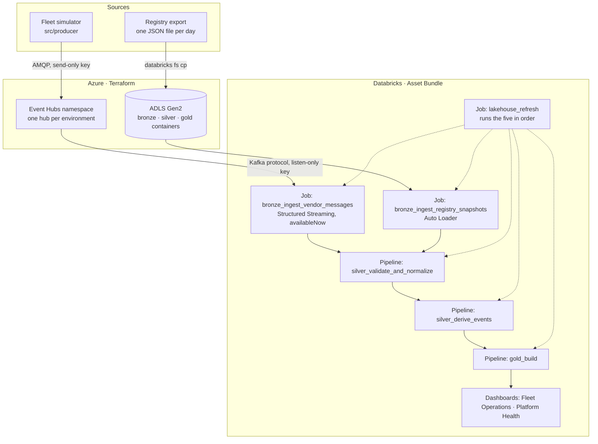
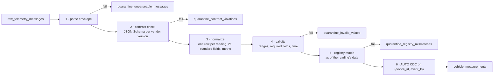

# Architecture

How the platform is built, layer by layer. Why each piece is built this way is in
[DECISIONS.md](DECISIONS.md); naming rules are in [CONVENTIONS.md](CONVENTIONS.md).

## 1. Purpose

Fleet companies buy tracking devices from different telematics vendors. The platform
receives every vendor's data, turns four incompatible formats into one, checks every
reading against the fleet registry, and answers five questions for each fleet company:

| # | Question | Asked by | Data product |
|---|---|---|---|
| 1 | Which vehicles need the workshop? | Maintenance managers | `vehicle_health` |
| 2 | Which drivers drive dangerously? | Safety officers, insurers | `driver_safety` |
| 3 | Where is fuel money being wasted? | Finance, operations | `fleet_cost_utilization` |
| 4 | Is any vehicle being misused? | Operations, security | `security_misuse` |
| 5 | What do we bill, and which vendor sends bad data? | The platform team | `platform_billing`, `vendor_data_quality` |

## 2. Overview



| Unity Catalog schema | Holds | Written by |
|---|---|---|
| `bronze` | Data exactly as received | Two notebook jobs |
| `silver` | Validated readings, quarantine, master data, events | Two Lakeflow pipelines |
| `gold` | Dimensions, facts, data products, access table | One Lakeflow pipeline, one setup notebook |
| `reference` | Lookup tables loaded from `reference/*.csv` | The silver pipeline |
| `operations` | Pipeline event log, run log, quarantine summary, reconciliation | The silver pipeline |

Each environment has its own catalog: `iot_dev` and `iot_prod`.

## 3. Sources

### 3.1 Vendor telemetry

A gateway wraps every vendor message in the same envelope before it reaches Event Hubs:

```json
{
  "envelope_version": "1.0",
  "message_id": "2e1a7ac9-efd3-43ce-90e9-8df025f3ca52",
  "vendor_id": "fpl",
  "contract": "fpl.telemetry.v2",
  "received_at": "2026-11-08T21:30:35.336387+00:00",
  "payload": { "deviceId": "FPL-3FE12E", "speedKph": 12.3, "engine": { "tempC": 81.3 } }
}
```

The partition key is the device ID, so each device's messages stay in order within one
partition. The four payload formats:

| Vendor | Contract | Shape |
|---|---|---|
| TelemaxPro `tmx` | `tmx.telemetry.v1` | Flat JSON, metric units, ISO timestamps |
| FleetPulse `fpl` | `fpl.telemetry.v1` | camelCase, imperial units (mph, °F, psi, miles), epoch milliseconds |
| FleetPulse `fpl` | `fpl.telemetry.v2` | Firmware 2: metric units, nested `engine` and `location`, ISO timestamps |
| GeoTrak `gtk` | `gtk.telemetry.v1` | Nested objects, timestamps without a time zone, rounded to the second |
| AutoSense `ats` | `ats.telemetry.v1` | Several readings batched in one message, terse keys, epoch seconds |

Each contract is a JSON Schema in `contracts/`. Which contracts each vendor may send, and
which one is current, is in `reference/vendor_contract_versions.csv`.

### 3.2 Fleet registry

The registry is the system of record for clients, vehicles, drivers, device fittings and
fuel prices. It arrives as one JSON file per day, named `fleet_registry_YYYY-MM-DD.json`;
the date in the name becomes the snapshot version.

### 3.3 The simulator

`src/producer/` plays all four vendors and the registry. It keeps a stateful fleet
(position, odometer, fuel, engine temperature, driver on shift), persisted between runs in
`producer_state_<env>.json`, so a restart continues the same fleet. It plants the problems a
real platform meets:

| Planted problem | Rate or target |
|---|---|
| Malformed messages: broken JSON, missing payload, unknown vendor | 1% of messages |
| Readings sent from a clock that runs behind | 5% of readings |
| Sensor glitches producing impossible values | 0.3% of readings |
| A retired device still transmitting | C001-V001 |
| A device reporting the wrong VIN | C003-V001 |
| A device nobody registered | C006-V001 |
| A device reporting another client's account | C008-V001 |
| Vehicles whose cooling fails | 6 vehicles |
| Drivers who take vehicles out after hours | 6 drivers |
| Temporary drivers on fobs that were never registered | Some shifts |
| Firmware rollout to a new contract version | `--fpl-v2-share`, decided per device |

| Profile | Clients | Vehicles | Live interval |
|---|---|---|---|
| `dev` | 4, one per vendor | 24 | 15 s |
| `prod` | 9 | 44 | 5 s |

## 4. Bronze

| Table | One row is | Written by |
|---|---|---|
| `raw_telemetry_messages` | One Event Hubs message: the raw text, partition key, Kafka partition and offset, enqueue time, ingest time | `notebooks/01_bronze_ingest_vendor_messages.py`, Structured Streaming over the Event Hubs Kafka endpoint, `availableNow` trigger, at most 10,000 offsets per micro-batch |
| `raw_registry_snapshots` | One registry file: the raw text, file name, snapshot date | `notebooks/02_bronze_ingest_registry_snapshots.py`, Auto Loader over the landing volume |

Bronze never parses and never changes a row. Every later layer can be rebuilt from it.

## 5. Silver: from messages to trusted readings

Pipeline `silver_validate_and_normalize`, defined in `pipelines/silver/telemetry.py`,
`master_data.py`, `reference.py` and `operations.py`.

### 5.1 Processing order



| Step | Function | Failure reasons |
|---|---|---|
| 1 Parse | `src/iot/silver/telemetry.py: parse_envelope` | `malformed_json`, `missing_payload`, `unknown_vendor` |
| 2 Contract | `telemetry.py: check_contract` | `schema_violation`, `unsupported_contract` |
| 3 Normalize | `src/iot/silver/normalize.py: normalize` | none: a field that is absent becomes null |
| 4 Validity | `src/iot/silver/validity.py: check_validity` | `missing_required_value`, `sensor_out_of_range`, `gps_null_island`, `coordinates_out_of_range`, `event_in_future` |
| 5 Match | `src/iot/silver/matching.py: match_registry` | `unknown_device`, `inactive_device`, `device_vin_mismatch`, `client_vendor_mismatch` |
| 6 Store | `src/iot/silver/measurements.py`, AUTO CDC | duplicates collapse, the copy received last wins |

Every step runs in the same streaming query, so a message is processed exactly once and each
checkpoint covers the whole chain. Steps 1 to 5 are temporary views; only the quarantine
tables and `vehicle_measurements` are stored.

### 5.2 Normalization

`reference/vendor_field_mappings.csv` says, per vendor and contract, which raw path becomes
which standard field and which conversion applies: `mph_to_kph`, `fahrenheit_to_celsius`,
`epoch_milliseconds`, `naive_utc_timestamp` and eight others. The CSV chooses a conversion by name; the code
holds a fixed vocabulary of Spark expressions, so configuration can never run code.

Paths can be nested (`engine.tempC`) or point into arrays (`readings[].spd`). An array path
explodes the message into one row per element, so an AutoSense message of three readings
becomes three rows with `reading_index` 0, 1 and 2.

Normalization is a single query whatever the number of contracts: every standard field is a
`CASE` on the contract. See [DECISIONS.md, ADR-006](DECISIONS.md#adr-006-one-query-shape-for-every-contract).

### 5.3 Registry matching

| # | Check | Result |
|---|---|---|
| 1 | The device exists in the registry | fail: `unknown_device` |
| 2 | An assignment covers the reading's date (`valid_from` inclusive, `valid_to` exclusive) | fail: `inactive_device` |
| 3 | The reported VIN is the fitted vehicle's VIN | fail: `device_vin_mismatch` |
| 4 | The reported account is the vehicle's client, and that client uses this vendor | fail: `client_vendor_mismatch` |
| 5 | The driver's fob belongs to a driver of that client | warn: `driver_unmatched`, reading kept |

A reading that passes takes `vehicle_id`, `client_id` and `driver_id` from the registry,
never from the device. Every join is a left join, so each reading comes out passed, warned
or failed, and none disappears.

### 5.4 Master data

Built from `raw_registry_snapshots`, in `pipelines/silver/master_data.py`.

| Table | History | How |
|---|---|---|
| `clients`, `vehicles`, `drivers` | SCD type 2 | AUTO CDC from snapshot: each day's file is compared with the last, changes become new versions |
| `device_assignments` | As the registry sends it | The registry already carries `valid_from` and `valid_to` per fitting |
| `vendors`, `regions`, `fuel_prices` | Latest snapshot | Materialized views |

### 5.5 Quarantine

All four tables share one shape (`QUARANTINE_COLUMNS` in `telemetry.py`): the message and
reading identity, device and event time when known, the raw payload where it helps, the
stage, a reason code, a readable detail, the Kafka position, and timestamps.

| Table | Holds | Raw payload kept |
|---|---|---|
| `quarantine_unparseable_messages` | Messages that cannot be read at all | Yes |
| `quarantine_contract_violations` | Messages that break their contract | Yes |
| `quarantine_invalid_values` | Readings with impossible values | No: the normalized row is enough |
| `quarantine_registry_mismatches` | Readings the registry rejects | No |

### 5.6 Operations

| Table | One row is |
|---|---|
| `silver_validate_and_normalize_event_log` | One Lakeflow event, published by the pipeline |
| `pipeline_runs` | One finished pipeline update: duration, state, flows, rows stored, rows quarantined, expectation failures |
| `pipeline_flow_runs` | One flow in one update |
| `quarantine_summary_by_hour` | Failures per arrival hour, stage, reason and vendor |
| `silver_reconciliation` | The proof that no reading was lost or invented; see [DATA_QUALITY.md](DATA_QUALITY.md) |

## 6. Silver: events

Pipeline `silver_derive_events`, `pipelines/silver/events.py`, logic in
`src/iot/silver/events.py`. A single reading cannot say "the engine started"; only the
comparison with the vehicle's previous reading can. Every table uses one of three patterns:
change detection (`lag`), gaps and islands (number consecutive readings where a condition
holds, then aggregate each group), or bucket counting.

| Table | One row is | Rule |
|---|---|---|
| `vehicle_ignition_events` | The engine switching on or off | Change in `ignition_on` |
| `vehicle_trips` | One journey by one driver | Ignition on to off; a stop shorter than 10 minutes joins two drives into one trip; a different driver's fob taking over starts a new trip |
| `vehicle_idling_events` | One idle period | Engine on, stationary, at least 2 minutes |
| `vehicle_speeding_events` | One sustained overspeed | Above 120 km/h for at least 4 minutes |
| `driver_change_events` | A different fob taking over a vehicle | Change in fob |
| `vehicle_diagnostic_events` | A fault code appearing or clearing | Change in fault codes, with description and severity |
| `geofence_events` | Leaving or returning to the region | Distance from the depot crossing 50 km |
| `vehicle_refuel_events` | One refuel | Fuel level rising at least 5 percentage points |
| `driver_behavior_events` | One harsh brake or acceleration | Harsh-event counters |
| `device_heartbeats` | One device per 15 minutes: messages received, or silent | Counted from bronze, so a device sending only broken messages is still alive |

Thresholds come from `reference/anomaly_thresholds.csv`. Event IDs are hashes of their
identity, so a recompute gives every event the same ID.

**Out-of-sequence readings.** Ordering by event time assumes the device clock is right. A
device whose clock runs behind sends current values under an older timestamp, which looks
like the vehicle jumping forward and back. `flag_out_of_sequence` keeps the longest
non-decreasing run of odometer values per vehicle and day, the readings an odometer that can
only go up allows, and every event table leaves the rest out.

These tables are materialized views over the whole of `vehicle_measurements`, so a late
reading is sorted into place on the next run instead of being lost.

## 7. Gold

Pipeline `gold_build`, `pipelines/gold/`, logic in `src/iot/gold/`.

### 7.1 Dimensions

| Table | Grain | Notes |
|---|---|---|
| `dim_client` | One client version | SCD2 date ranges from the silver history |
| `dim_vehicle` | One vehicle version | SCD2 |
| `dim_driver` | One driver version | SCD2, including moves between clients |
| `dim_device` | One fitting of a device to a vehicle | From `device_assignments` |
| `dim_date` | One calendar day | Spans every reading and fuel price; `date_key` is `yyyymmdd` |

Surrogate keys are SHA-256 hashes of the natural key and version, so they are the same on
every rebuild. Each dimension has an `unknown` member, and the first version of each entity
is open from 1900-01-01, so a fact older than the first snapshot still finds its dimension.

### 7.2 Facts

| Table | Grain | Keys |
|---|---|---|
| `fact_trip` | One trip | The dimension versions in force when the trip started ("as was") |
| `fact_vehicle_day` | One vehicle per local day it reported or was expected to | Usage, fuel cost, engine health, faults, refuels, geofence exits, silent minutes |
| `fact_driver_day` | One driver per local day they drove | Distance, time, harsh events, speeding, after-hours trips |

Days are local days in each vehicle's region, not UTC days. Fuel is priced at the region's
price on the day.

### 7.3 Data products

| Table | Grain | Answers |
|---|---|---|
| `vehicle_health` | Vehicle per day | Status `critical`, `attention`, `ok` or `no_data`, with the reason in minutes and codes |
| `driver_safety` | Driver per day | Harsh events and speeding per 100 km, a 0 to 100 score |
| `fleet_cost_utilization` | Client per day | Fuel cost, idle cost and its share, cost per km, vehicles active and reporting |
| `security_misuse` | Vehicle per day with something to review | After-hours trips and distance, geofence exits, trips with nobody logged in |
| `platform_billing` | Client, vendor and day | Billable devices: a device that sent at least one message |
| `vendor_data_quality` | Vendor per day | Messages received and quarantined, readings stored and quarantined, rates |

Every product with a `client_id`, all but `vendor_data_quality`, carries a row filter on it,
and `vehicle_health` masks the VIN. See [SECURITY.md](SECURITY.md).

## 8. Serving

| Dashboard | For | Runs queries as |
|---|---|---|
| Fleet Operations: vehicle health, driver safety, cost and utilization, misuse | Each fleet company's managers | The viewer, so row filters apply |
| Platform Health: pipeline and reconciliation, vendors and billing | The platform team | The publisher |

Layouts are defined in `src/iot/dashboards.py`, queries in `dashboards/*.sql`, and
`python -m src.iot.dashboards` generates the Lakeview files the bundle deploys. Datasets are
row level, one row per vehicle-day or driver-day, so the dashboard filters work by filtering
rows; logic a widget cannot express, such as a period safety score, is computed in the SQL.

## 9. Orchestration

`lakehouse_refresh` runs five tasks, each after the one before succeeds:

```
bronze_registry_snapshots → bronze_vendor_messages → silver_validate_and_normalize
                          → silver_derive_events → gold_build
```

They run strictly one at a time: each starts its own single-node 4-vCPU cluster, and the
subscription's quota allows one. A failed run is resumed with "Repair run" from the failed
task; streaming steps continue from their checkpoints.

Event Hubs keeps messages for 3 days, so the refresh must run at least that often.

## 10. Environments

| | dev | prod |
|---|---|---|
| Catalog | `iot_dev` | `iot_prod` |
| Event Hub | `vehicle-telemetry-dev` | `vehicle-telemetry-prod` |
| Listen secret | `eventhub-listen-conn-dev` | `eventhub-listen-conn-prod` |
| Producer profile | 4 clients, 24 vehicles | 9 clients, 44 vehicles |
| Bundle mode | development: names prefixed with the developer | production |
| Deployed by | The developer, `databricks bundle deploy` | CI/CD only, as a service principal |
| Owned and run by | The developer | The service principal `iot-lakehouse-cicd` |
| People can | Change anything | View only |

The code is written once; the catalog, hub and secret come from bundle variables.

## 11. Infrastructure

Terraform in `infra/` creates, in one resource group:

| Resource | Purpose |
|---|---|
| Storage account, ADLS Gen2, containers `bronze`, `silver`, `gold`, `volumes` | Unity Catalog external locations and volumes |
| Event Hubs namespace, Standard tier, one hub per environment | Telemetry transport; a send-only and a listen-only key per hub |
| Databricks workspace, Premium | Unity Catalog, row filters, Lakeflow |
| Access connector and a `Storage Blob Data Contributor` role assignment | Unity Catalog's identity for the storage account |
| Subscription budget | Spending alerts |

Connection strings are Terraform outputs marked sensitive; the listen keys are stored in the
Databricks secret scope `iot`, and the send keys never leave the producer's machine.
