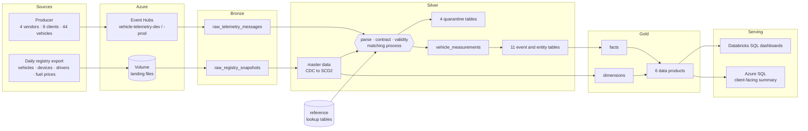

# Architecture

The single source of truth for what this project builds. Naming rules live in
[CONVENTIONS.md](CONVENTIONS.md); everything else is here.

## 1. Purpose

A fleet intelligence platform. Fleet companies buy tracking devices from different
telematics vendors. We receive every vendor's data, turn four incompatible formats into
one, and answer five business questions for each fleet company:

| # | Question | Asked by |
|---|---|---|
| 1 | Which vehicles are about to fail? | Maintenance managers |
| 2 | Which drivers drive dangerously? | Safety officers, insurers |
| 3 | Where is money being wasted? | Finance, operations |
| 4 | Is anything being misused? | Operations, security |
| 5 | What do we bill, and which vendor sends bad data? | Us, the platform |

## 2. Overview



## 3. Sources

| Source | Arrives as | Frequency | Lands in |
|---|---|---|---|
| Vendor telemetry | JSON messages on Event Hubs, wrapped in the gateway envelope | Continuous while the producer runs | `bronze.raw_telemetry_messages` |
| Fleet registry | One JSON file per day in a Unity Catalog Volume | Daily | `bronze.raw_registry_snapshots` |

The four vendor formats:

| Vendor | Format |
|---|---|
| TelemaxPro `tmx` | Flat, metric, ISO timestamps |
| FleetPulse `fpl` | camelCase, imperial units (mph, °F, psi, miles), epoch milliseconds |
| GeoTrak `gtk` | Nested objects, metric, timestamps with no zone |
| AutoSense `ats` | Several readings batched per message, terse keys, epoch seconds |

Each format has a JSON Schema contract in `contracts/`.

## 4. Layers

| Layer | Holds | Rule |
|---|---|---|
| Bronze | Data exactly as received | One table per source. Never parsed, never changed. |
| Silver | Clean business entities | One row is one real thing or event. All vendors in one shape, metric units. |
| Gold | Star schema and data products | Built for questions, not for storage. |
| Reference | Lookup tables | Small, slowly changing, maintained by us. |
| Operations | Run logs and audit | One row per pipeline run. |

Calculated things (trips, scores, events) never appear in bronze: vendors do not send them.

## 5. Bronze

| Table | One row is | Written by |
|---|---|---|
| `raw_telemetry_messages` | One Event Hubs message, raw JSON text plus Kafka partition and offset | Structured Streaming, `availableNow` trigger |
| `raw_registry_snapshots` | One registry file, raw JSON text plus file name and snapshot date | Auto Loader |

## 6. Silver

### 6.1 Processing order

```
raw message
  1. parse          envelope and payload JSON          fail → quarantine_unparseable_messages
  2. contract       payload matches its vendor schema  fail → quarantine_contract_violations
  3. normalize      vendor fields → standard fields, units → metric   (driven by vendor_field_mappings)
  4. validity       timestamps and value ranges        fail → quarantine_invalid_values
  5. matching       device, VIN, client, driver        fail → quarantine_registry_mismatches
  6. deduplicate    by message_id, then record_hash    dropped, counted in operations
  7. write          vehicle_measurements
  8. derive         event and entity tables
```

### 6.2 Nested JSON

| Nested shape | Example | Handling |
|---|---|---|
| Object with single values | GeoTrak `engine.rpm` | Flattened into columns |
| List of the same thing | AutoSense `readings[]` | Exploded, one row per element |
| A different entity inside | FleetPulse `faultCodes[]` | Becomes rows in its own entity table |

### 6.3 Matching process

Every reading is checked against the registry as it was at the reading's event time
(a point-in-time join on each assignment's `valid_from` and `valid_to`).

| # | Check | On failure |
|---|---|---|
| 1 | Device exists in the registry | quarantine: `unknown_device` |
| 2 | Device was active at event time | quarantine: `inactive_device` |
| 3 | Reported VIN matches the VIN the device was fitted to | quarantine: `device_vin_mismatch` |
| 4 | Reported account is the vehicle's client, and that client uses this vendor | quarantine: `client_vendor_mismatch` |
| 5 | Driver fob belongs to a driver of that client | kept, flagged `driver_unmatched` |

A passing reading takes `vehicle_id`, `client_id` and `driver_id` from the registry,
never from the device. Check 5 is soft: an unknown driver does not invalidate engine data.

**Replay.** When the registry is corrected (for example a device registered after its data
arrived, a late-arriving dimension), the matching process re-runs on quarantined rows.
Rows that now pass move to silver and are marked `replayed` in quarantine.

### 6.4 Core table

| Table | One row is |
|---|---|
| `vehicle_measurements` | One validated, matched reading: identity, event time, location, speed, engine, fuel, battery, fault code, harsh-event counts |

### 6.5 Event and entity tables

| Table | One row is | Derived from |
|---|---|---|
| `vehicle_ignition_events` | Engine switched on or off | Changes in `ignition_on` |
| `vehicle_trips` | One journey: start, end, distance (odometer and GPS), duration, fuel used, idle time, max speed | Pairs of ignition events |
| `vehicle_idling_events` | One idle period: start, end, duration, fuel wasted | Engine on, speed zero, longer than 2 minutes |
| `vehicle_speeding_events` | One overspeed period: duration, max speed, limit | Speed above threshold |
| `driver_behavior_events` | One harsh brake or harsh acceleration | Harsh-event counts |
| `driver_change_events` | A driver logging in or out with their fob | Changes in reported fob |
| `vehicle_diagnostic_events` | A fault code appearing or clearing | Changes in fault code |
| `geofence_events` | Vehicle leaving or returning to its region | Distance from depot crossing the radius |
| `vehicle_refuel_events` | One tank fill: litres added | Jumps in fuel level |
| `device_heartbeats` | One device per 15 minutes: messages received, or silent | All messages, including quarantined |

Idling, speeding and driver behavior events carry the `trip_id` they happened in.

### 6.6 Master data

Built from registry snapshots through CDC (section 9).

| Table | One row is | History |
|---|---|---|
| `vendors` | A telematics vendor | Current only |
| `clients` | A fleet company | Current only |
| `vehicles` | A vehicle | Current only |
| `drivers` | A driver and their fob | Current only |
| `device_assignments` | A device fitted to a vehicle for a period | Full history (SCD2) |
| `fuel_prices` | Price per litre per region per day | Append |

### 6.7 Quarantine

| Table | Holds | Data shape | Replayable |
|---|---|---|---|
| `quarantine_unparseable_messages` | Not JSON, truncated, no payload, unknown vendor | Raw text | Rarely |
| `quarantine_contract_violations` | Payload breaks its contract, unsupported contract version | Envelope plus violation list | Yes, after a contract or parser change |
| `quarantine_invalid_values` | Impossible values, missing, future or too-old timestamps | Normalized row plus failed rule | No |
| `quarantine_registry_mismatches` | Failed matching checks 1 to 4 | Normalized row plus expected and received values | Yes, after a registry fix |

`quarantine_summary_by_hour` is a view across all four, by stage, reason and vendor.

## 7. Reference (lookup tables)

| Table | Holds |
|---|---|
| `vendor_field_mappings` | Per vendor and contract version: source field path → standard field, unit conversion |
| `vendor_contract_versions` | Which contract versions each vendor may send, and which is current |
| `fault_codes` | Code, description, severity |
| `anomaly_thresholds` | Temperature, pressure, speed, idle and heartbeat limits |
| `regions` | Depot location, geofence radius, time zone |

`vendor_field_mappings` makes normalization config-driven: onboarding a fifth vendor, or a
new contract version, is new rows in this table rather than new code.

## 8. Gold

### Dimensions
| Table | Notes |
|---|---|
| `dim_vendors`, `dim_clients`, `dim_regions` | Type 1 |
| `dim_vehicles` | Type 1 |
| `dim_drivers` | Type 1 |
| `dim_devices` | Type 2: which vehicle each device was fitted to, over time |
| `dim_fault_codes` | From reference |
| `dim_dates` | Calendar |

Surrogate keys end in `_key`.

### Facts
| Table | Grain |
|---|---|
| `fact_vehicle_trips` | One trip |
| `fact_driver_behavior_events` | One harsh event |
| `fact_vehicle_speeding_events` | One speeding period |
| `fact_vehicle_idling_events` | One idle period |
| `fact_vehicle_diagnostic_events` | One fault code occurrence |
| `fact_geofence_events` | One exit or return |
| `fact_vehicle_refuel_events` | One refuel |
| `fact_vehicle_daily_activity` | One vehicle per day: distance, engine hours, idle hours, fuel litres and cost |

### Data products
| Table | Answers question |
|---|---|
| `vehicle_health_daily` | 1 · overheating trend, fault codes, service due |
| `driver_safety_daily` | 2 · per driver: harsh events, speeding, night driving, score |
| `fleet_cost_utilization_daily` | 3 · per vehicle: idle cost, fuel cost per km, utilization |
| `security_alerts` | 4 · after-hours use, geofence exits |
| `vendor_data_quality_daily` | 5 · late, quarantined and silent messages per vendor |
| `client_billing_monthly` | 5 · active devices per client |

## 9. CDC and CDF

| | Change Data Capture | Change Data Feed |
|---|---|---|
| Meaning | Detecting changes in a source | A Delta table recording its own row-level changes |
| Used for | Registry snapshots: compare each day's file with the previous to find new, changed and removed rows, feeding SCD2 `device_assignments` and `dim_devices` | Silver tables that are updated, not only appended: `device_assignments`, the quarantine tables (replay flag) |
| Not used for | Telemetry, which only ever adds new events | Append-only tables, which are read as plain streams |

## 10. Processing and orchestration

| Part | Tool | Reason |
|---|---|---|
| Bronze telemetry | Hand-written Structured Streaming | Teaches checkpoints and offsets |
| Bronze registry | Auto Loader | Incremental file ingestion |
| Silver and gold | Lakeflow Declarative Pipeline | Expectations for data quality, AUTO CDC for SCD2, lineage |
| Orchestration | One job: bronze → pipeline → quality checks → run log | One trigger, one schedule |

| Environment | Schedule |
|---|---|
| dev | Manual |
| prod | Once a day |

Event Hubs keeps messages for three days, so a run must happen at least every three days.

## 11. Environments and deployment

| | dev | prod |
|---|---|---|
| Event Hub | `vehicle-telemetry-dev` | `vehicle-telemetry-prod` |
| Catalog | `iot_dev` | `iot_prod` |
| Producer profile | 4 clients, 24 vehicles | 9 clients, 44 vehicles |
| Deployed by | A developer, `databricks bundle deploy -t dev` | CI/CD only, from `main` |
| Runs as | The developer | A service principal |

Code is written once; catalog, hub and secret come from bundle variables.

## 12. Security

| Control | Implementation |
|---|---|
| Least-privilege Event Hubs access | Send-only and listen-only policies per hub |
| No secrets in code | Databricks secret scope; Terraform outputs marked sensitive |
| Client isolation | Unity Catalog row filters: each client sees only its own vehicles |
| VIN protection | Unity Catalog column mask on client-facing views |

## 13. Serving

| Consumer | Through |
|---|---|
| Analysts, dashboards | Databricks SQL warehouse over gold |
| Client-facing application | Daily fleet-health summary per client pushed to Azure SQL Database (free tier) |

## 14. Operations

| Table | One row is |
|---|---|
| `pipeline_runs` | One job run: rows read, written, quarantined and deduplicated per stage, duration, status |

Reconciliation, checked every run:
`bronze rows = silver rows + quarantined rows + duplicates dropped`.

## 15. Constraints and trade-offs

| Constraint | Consequence |
|---|---|
| Azure for Students: 6 vCPU, no quota increases, region allowlist | One 4-vCPU cluster at a time; region `uaenorth` |
| One workspace | dev and prod separated by catalog, hub, secret and identity, not by workspace. At scale they would be separate workspaces. |
| $100 credit | Job clusters only while running, daily prod schedule, Photon off |
| University tenant blocks Entra ID | Databricks-managed service principal for CI/CD |
| Resource group named `dev` | Historical; renaming recreates the platform |