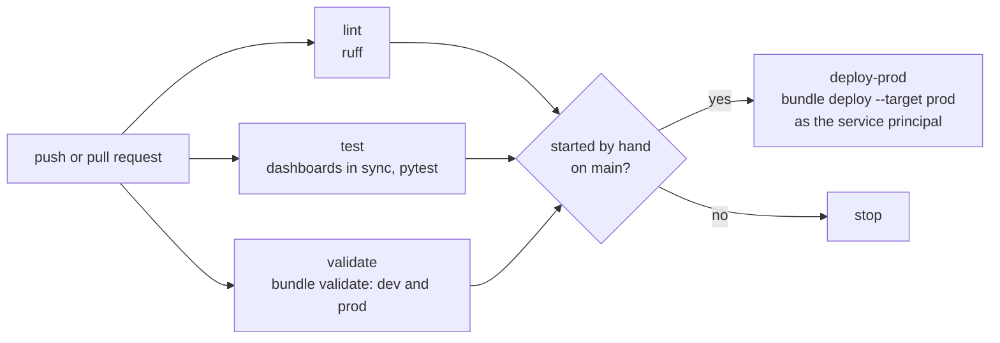

# CI/CD

One workflow, `.github/workflows/ci.yml`, tests every change and deploys production only when
someone decides to.

## Jobs

| Job | Runs | What it does |
|---|---|---|
| `lint` | Every push and pull request | `ruff check` |
| `test` | Every push and pull request | Regenerates the dashboard files and fails if they differ from git; then `pytest -m "not slow"` on branches and pull requests, the full suite on `main` |
| `validate` | When Databricks access is configured | Installs the pinned Databricks CLI and runs `databricks bundle validate` for both targets as the service principal |
| `deploy-prod` | Only on a manual run on `main`, after the three above pass | `databricks bundle deploy --target prod` |

## Test strategy

416 tests run against local Spark: pure functions in `src/iot/` take DataFrames and return
DataFrames, so every rule is tested without a cluster. The three slowest modules (events,
gold facts and the end-to-end silver chain) are marked `slow`:

| Set | Tests | Runs on |
|---|---|---|
| Fast, `pytest -m "not slow"` | 320 | Every push and pull request |
| Full, `pytest` | 416 | Every push to `main` |

Locally on Windows, Spark cannot reuse its Python worker processes, which makes the suite
many times slower than on Linux. Run the module you changed locally and let CI run the rest.

## Deploying production

1. Merge to `main`. CI runs the full suite and validates both targets.
2. In GitHub, **Actions → CI/CD → Run workflow → `main`**.
3. `deploy-prod` deploys as the service principal `iot-lakehouse-cicd`, which then owns every
   prod job, pipeline and dashboard.

The `prod` GitHub environment accepts deployments from `main` only. Required reviewers on the
environment, which need a paid plan for private repositories, are enabled once the repository
is public.

Dev is not deployed by CI. A bundle in development mode belongs to the person deploying it, so
a CI deploy would create a second, service-principal-owned copy instead of updating the
developer's own. Each developer deploys dev with `databricks bundle deploy`.

## Authentication

OAuth machine-to-machine: the CLI reads `DATABRICKS_HOST` (a repository variable),
`DATABRICKS_CLIENT_ID` and `DATABRICKS_CLIENT_SECRET` (repository secrets). The `validate` and
`deploy-prod` jobs are skipped automatically while `DATABRICKS_HOST` is not set, which is how
the workflow behaves after the platform is torn down.

## Reliability details

| Detail | Why |
|---|---|
| The Databricks CLI version is pinned, `DATABRICKS_CLI_VERSION` | CI and local development behave the same |
| The CLI is downloaded through the authenticated GitHub API, with retries | Anonymous release downloads timed out with HTTP 504 during a GitHub incident |
| Dashboards are regenerated in CI and compared with git | A layout change cannot be deployed without its generated file |
| The dashboard generator writes `\n` line endings | Windows and Linux produce identical files |
| `deploy-prod` has its own concurrency group, never cancelled | Two deploys can never overlap |
| Branch runs cancel superseded runs; `main` runs never do | Fast feedback without losing a deploy |
