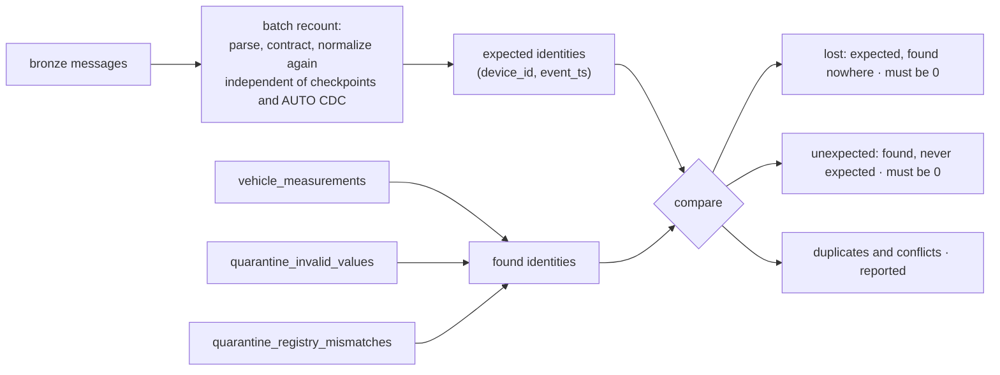

# Data Quality

The rule the platform is built on: **never assume clean data.** Every message is checked
five times before a reading reaches the clean data, every rejection is kept with its reason,
and an independent recount proves that nothing was lost or invented.

## 1. The checks

| Stage | Question | Failure reasons | Lands in |
|---|---|---|---|
| Parse | Can the message be read? | `malformed_json`, `missing_payload`, `unknown_vendor` | `quarantine_unparseable_messages` |
| Contract | Does it match the format its vendor agreed to send? | `schema_violation`, `unsupported_contract` | `quarantine_contract_violations` |
| Validity | Could these values be true? | `missing_required_value`, `sensor_out_of_range`, `gps_null_island`, `coordinates_out_of_range`, `event_in_future` | `quarantine_invalid_values` |
| Matching | Is the device who it claims to be? | `unknown_device`, `inactive_device`, `device_vin_mismatch`, `client_vendor_mismatch` | `quarantine_registry_mismatches` |
| Matching (soft) | Is the driver's fob registered to that client? | `driver_unmatched`: kept as a warning | `vehicle_measurements` |

### Contracts

Each vendor format version has a JSON Schema in `contracts/`, and
`reference/vendor_contract_versions.csv` lists which contracts each vendor may send:

| Vendor | Contract | Status |
|---|---|---|
| tmx | `tmx.telemetry.v1` | current |
| fpl | `fpl.telemetry.v1` | supported |
| fpl | `fpl.telemetry.v2` | current, since 2026-11-08 |
| gtk | `gtk.telemetry.v1` | current |
| ats | `ats.telemetry.v1` | current |

A violation is stored with the first error, located by JSON path, for example
`$.speedMph: 'fast' is not of type 'number'`.

### Validity limits

From `reference/validity_limits.csv`. A null value is missing, not invalid: it fails no range
check. Only `device_id` and `event_ts` are required.

| Field | Range | Why |
|---|---|---|
| `speed_kph` | 0 to 250 | No fleet vehicle exceeds it; beyond it the sensor is faulty |
| `engine_rpm` | 0 to 8,000 | Above any engine's redline |
| `engine_temperature_celsius` | −40 to 200 | Sensor range; real overheating is far below this |
| `coolant_pressure_kpa` | 0 to 400 | Above any cooling system's rating |
| `oil_pressure_kpa` | 0 to 1,000 | Above any engine's oil pressure |
| `battery_voltage` | 0 to 30 | Vehicle systems run at 12 or 24 volts |
| `fuel_level_percent` | 0 to 100 | A percentage |
| `odometer_km` | 0 to 3,000,000 | Beyond any vehicle's lifetime distance |
| `heading_degrees` | 0 to 360 | A compass bearing |
| harsh brake and acceleration counts | 0 to 100 | More between two readings means a faulty counter |

Timestamps are checked against the time the message reached Event Hubs, not the time the
pipeline runs, so replaying old data never looks like the future. Latitude and longitude both
exactly 0, "null island", is a GPS that has not fixed.

### Registry matching

Described in [ARCHITECTURE.md § 5.3](ARCHITECTURE.md#53-registry-matching). The device only
claims who it is; the registry, as it was on the reading's date, decides.

## 2. What prod caught

The first production run processed a 7-day backfill: 788,055 messages from 45 devices.

| Stage | Reason | Vendor | Quarantined | What it was |
|---|---|---|---|---|
| matching | `inactive_device` | tmx | 19,944 | C001-V001's retired device, still transmitting |
| matching | `client_vendor_mismatch` | ats | 19,936 | C008-V001's device reporting another client's account |
| matching | `device_vin_mismatch` | fpl | 19,930 | C003-V001's device reporting the wrong VIN |
| matching | `unknown_device` | gtk | 19,921 | C006-V001's device, never registered |
| parse | `malformed_json` | all | 2,994 | Broken JSON |
| parse | `unknown_vendor` | `zzz` | 1,649 | A vendor that does not exist |
| parse | `missing_payload` | all | 1,567 | An envelope with no payload |
| contract | `schema_violation` | all | 1,608 | Payloads breaking their contract |
| validity | `gps_null_island` | all | 936 | Latitude and longitude both 0 |
| validity | `sensor_out_of_range` | all | 861 | Impossible sensor values |
| validity | `event_in_future` | all | 873 | Timestamps after the message arrived |

Each integration fault is about 20,000 readings: one device's whole week at a reading every
30 seconds. Parse and contract failures together are 0.99% of messages, the simulator's 1%
corruption rate: one corruption in five is a value of the wrong type, which still parses and
is caught by the contract.

## 3. Reconciliation

`operations.silver_reconciliation` answers one question on every run: **did every reading
end up somewhere, exactly once?**



Two pipeline expectations, `no_reading_lost` and `no_reading_invented`, fail the run's
quality metrics if either number leaves 0.

### Latest production result

| Measure | Value |
|---|---|
| Bronze messages | 849,138 |
| Unparseable messages | 6,692 |
| Contract-violation messages | 1,728 |
| Expected readings | 970,015 |
| Stored readings | 881,557 |
| Invalid readings | 2,874 |
| Readings rejected by the registry | 85,299 |
| Duplicate copies | 321 |
| Identities whose copies differ in content | 321 |
| **Lost readings** | **0** |
| **Unexpected readings** | **0** |

### Why the counts do not simply add up

Stored, invalid and rejected are row counts of their tables. `vehicle_measurements` collapses
duplicates, but the quarantine tables are append-only: a reading delivered twice and rejected
twice appears there twice. Adding the counts therefore slightly overstates the total. This is
exactly the trap the first, count-based reconciliation fell into, reporting −3 readings
unaccounted for when nothing was missing, and the reason the check compares identities
([ADR-009](DECISIONS.md#adr-009-reconcile-by-identity-not-by-count)).

### Conflicting duplicates

All 321 duplicate copies have different content: two different readings claiming the same
device and the same second. GeoTrak sends timestamps rounded to the second, so two readings
taken within one second collide. AUTO CDC keeps the one received last; the reconciliation
reports the collision instead of hiding it. The fix belongs with the vendor: sub-second
timestamps.

## 4. Readings out of sequence

5% of readings come from devices whose clock runs behind, so their values are newer than
their timestamps. In time order they make a vehicle jump ahead and back. The odometer can
only go up, so per vehicle and day the platform keeps the longest non-decreasing run of
odometer values, and flags the rest as `out_of_sequence`:

```
odometer in time order:  100  117  101  102     →  keeps 100, 101, 102  (117 jumped ahead)
                         100  117  118  101 102 →  keeps 100, 101, 102  (two bad in a row)
```

Flagged readings stay in `vehicle_measurements` but are left out of trips and every other
event. On simulator data the rule finds 99.8% of shifted readings, with no false flags.

## 5. Schema evolution

FleetPulse firmware 2 changed the format: metric units, nested `engine` and `location`
objects, ISO timestamps. Supporting it took:

1. `contracts/fpl.telemetry.v2.json`
2. one row in `vendor_contract_versions.csv`, with v1 moved to `supported`
3. 21 rows in `vendor_field_mappings.csv`

No code changed. The simulator rolls firmware out per device, decided by a hash of the device
ID, so a device stays upgraded across runs. In prod, with a 30% rollout, 5 of 16 FleetPulse
devices sent v2 alongside 11 on v1, and silver read both in the same stream. A field the new
contract declares but nobody maps, `ambientTempC`, is ignored without error.

## 6. Late registration

C006-V001's device transmitted for a week before anyone registered it. Every reading was
quarantined as `unknown_device`. Then a registry snapshot including the device arrived:

| | Readings | First | Last |
|---|---|---|---|
| Quarantined before registration | 20,852 | 2026-11-02 09:09 UTC | 2026-11-09 18:23 UTC |
| Stored after registration | 599 | 2026-11-11 16:17 UTC | 2026-11-11 17:18 UTC |

No code changed and nothing was redeployed. Within the hour, C006-V001 appeared in vehicle
health as **critical**: 51 minutes above the critical engine temperature, peaking at 125 °C.
The bronze registry snapshots show when it happened: the 2026-11-09 snapshot has 52 device
assignments, the 2026-11-11 snapshot 53.

The backlog stays in quarantine by decision
([ADR-022](DECISIONS.md#adr-022-late-registration-is-fixed-forward-not-replayed)); how a replay
would recover it is in [LIMITATIONS.md](LIMITATIONS.md).

## 7. Tests

| Area | Tests |
|---|---|
| Parse, contract and quarantine shape | `tests/test_silver_telemetry.py` |
| Normalization, every vendor and conversion | `tests/test_normalize.py`, `tests/test_schema_evolution.py` |
| Validity rules | `tests/test_validity.py` |
| Registry matching, each planted fault | `tests/test_matching.py` |
| Deduplication | `tests/test_measurements.py` |
| Reconciliation, including the −3 case | `tests/test_operations.py` |
| The whole silver chain on simulator data | `tests/test_silver_end_to_end.py` |

The simulator plants each fault deliberately, so every test can assert the exact answer: each
planted fault found, each honest device passing.
