# Evidence

Screenshots and query results from the live production environment, `iot_prod`, taken before
the Azure resources were destroyed. Numbers are explained in [DATA_QUALITY.md](DATA_QUALITY.md).

## Dashboards

### Fleet Operations · Vehicle health
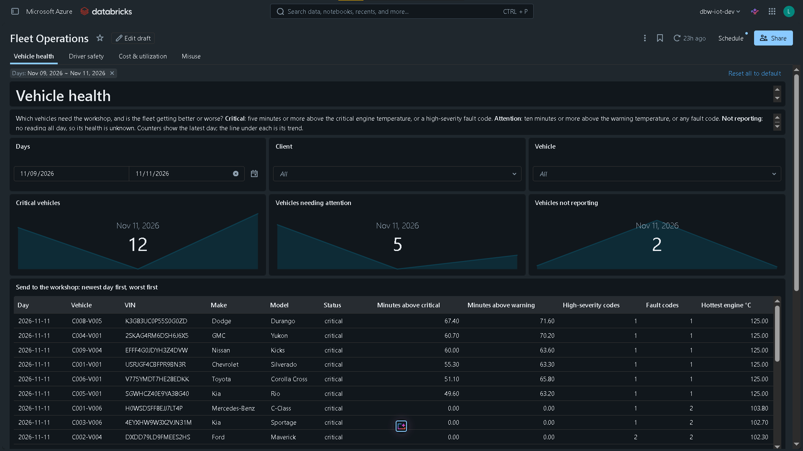
Nov 9 to 11. Nov 10 shows the whole fleet as not reporting: nothing was sent that day. On
Nov 11, C006-V001 appears as critical for the first time, an hour after its device was
registered.

### Fleet Operations · Driver safety
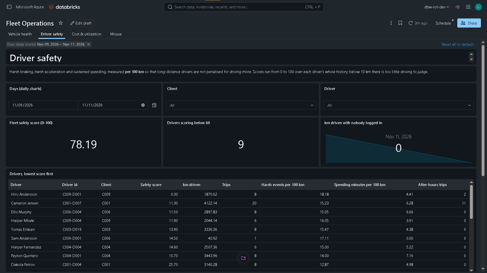

### Fleet Operations · Cost & utilization
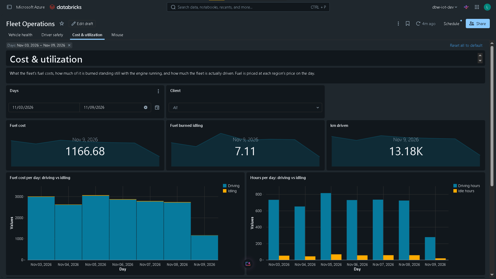

### Fleet Operations · Misuse
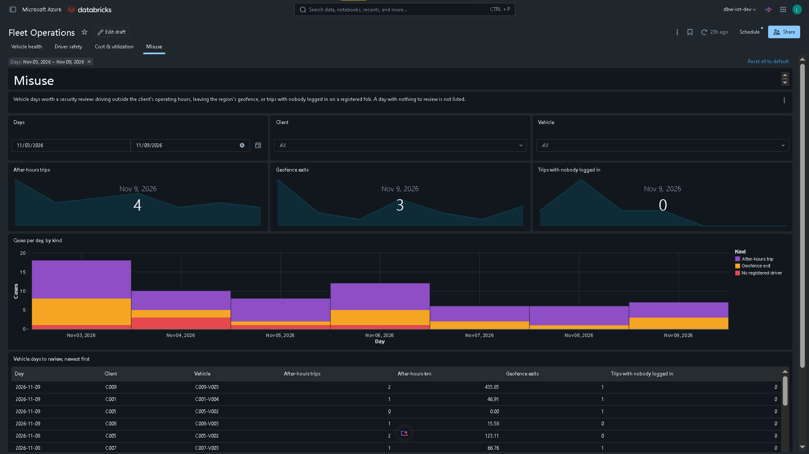

### Platform Health · Pipeline
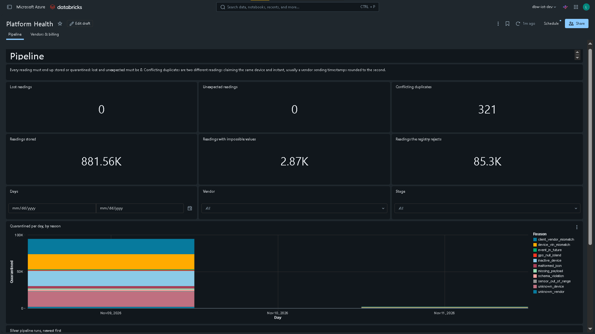
Lost and unexpected readings are 0; the quarantine chart shows each reason, the run log each
silver update.

### Platform Health · Vendors & billing
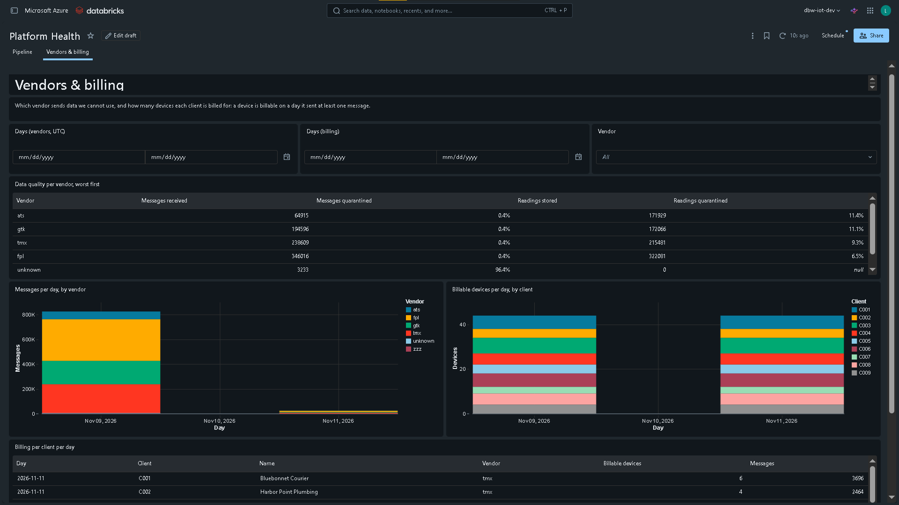

## Pipelines and lineage

### The refresh job
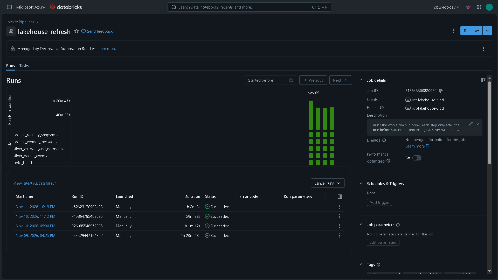

### Silver: validate and normalize

### Silver: events
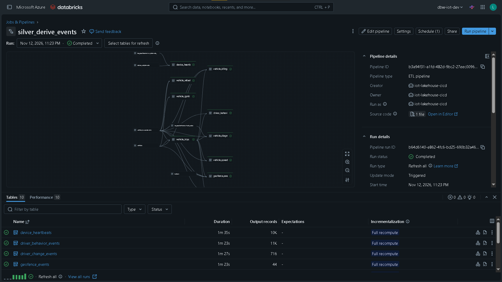

### Gold
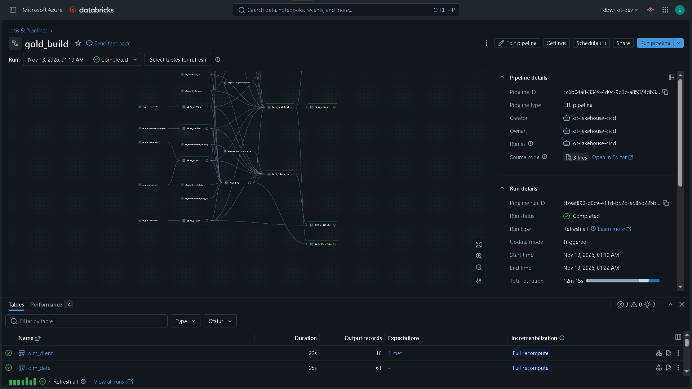

### Unity Catalog lineage
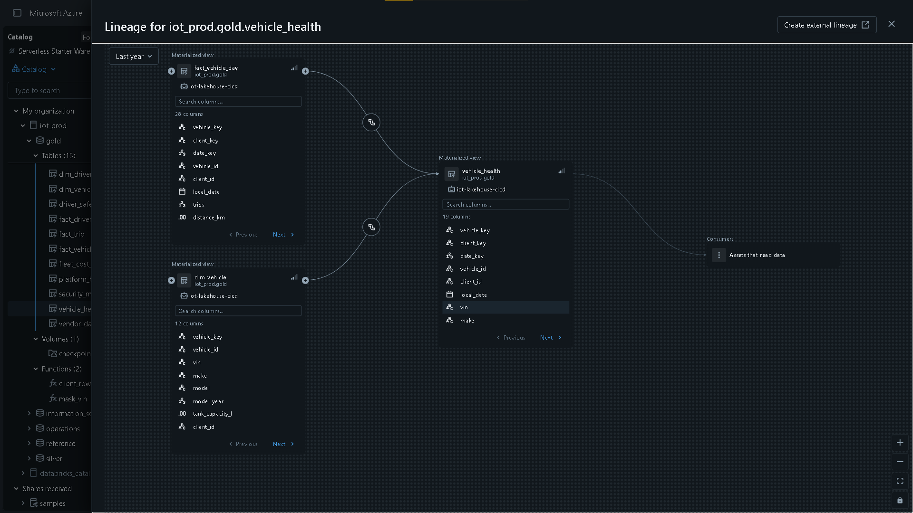

## CI/CD and governance

### A deploy to production
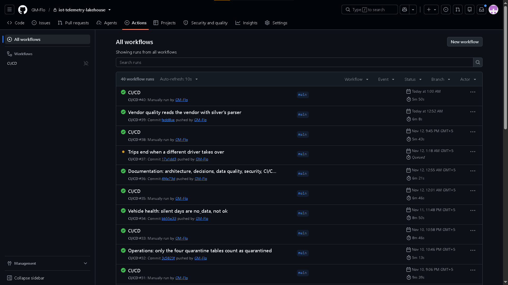
Lint, tests and bundle validation, then the deploy started by hand on `main`.

### Production belongs to the service principal
The refresh job screenshot above shows it: created by and run as `iot-lakehouse-cicd`. The
`users` group can only view prod resources.

## Query results

### Reconciliation
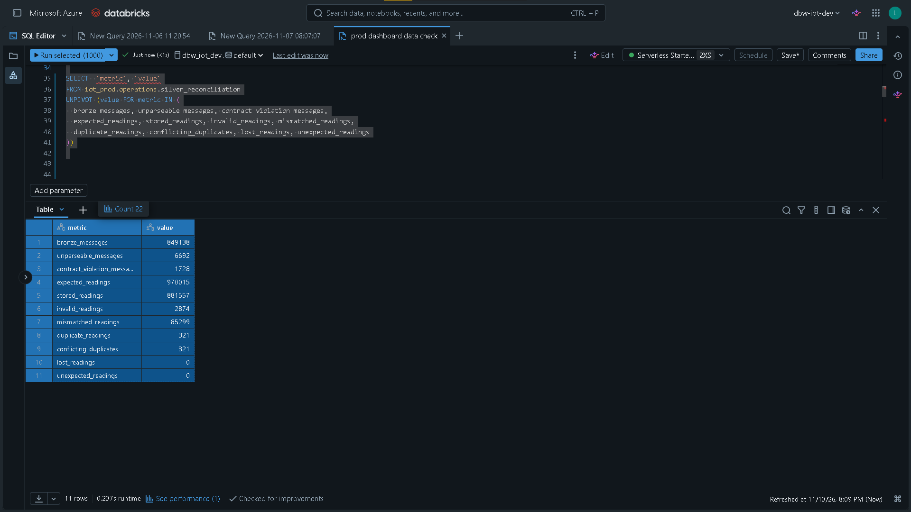

| bronze messages | expected readings | stored | invalid | rejected by registry | duplicates | conflicting | lost | unexpected |
|---|---|---|---|---|---|---|---|---|
| 849,138 | 970,015 | 881,557 | 2,874 | 85,299 | 321 | 321 | **0** | **0** |

### Late registration of C006-V001's device
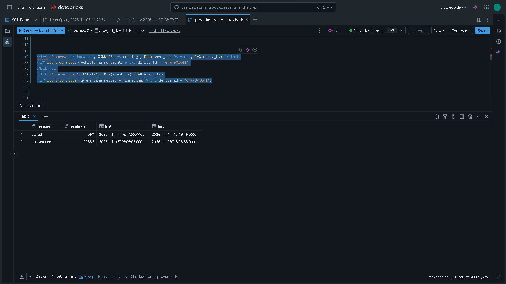

| | readings | first | last |
|---|---|---|---|
| stored | 599 | 2026-11-11 16:17:35 UTC | 2026-11-11 17:18:46 UTC |
| quarantined | 20,852 | 2026-11-02 09:09:02 UTC | 2026-11-09 18:23:58 UTC |

### Schema evolution: FleetPulse v1 and v2 side by side

| contract | messages | devices |
|---|---|---|
| `fpl.telemetry.v1` | 6,732 | 11 |
| `fpl.telemetry.v2` | 3,063 | 5 |

### Vehicle health after the `no_data` fix

| local date | critical | attention | ok | no data |
|---|---|---|---|---|
| 2026-11-09 | 9 | 16 | 16 | 3 |
| 2026-11-10 | | | | 44 |
| 2026-11-11 | 12 | 5 | 25 | 2 |

The three vehicles without data on Nov 9 are the three whose devices the registry rejects; on
Nov 11 only two remain, because C006-V001's device was registered.

### Silver pipeline runs

| started | state | seconds | flows | failed flows | readings stored | rows quarantined | expectation failures |
|---|---|---|---|---|---|---|---|
| 2026-11-09 11:43 UTC | COMPLETED | 2,519 | 21 | 0 | 817,578 | 90,219 | 0 |
| 2026-11-10 16:42 UTC | COMPLETED | 1,750 | 21 | 0 | 38,444 | 4,244 | 0 |

## Azure cost
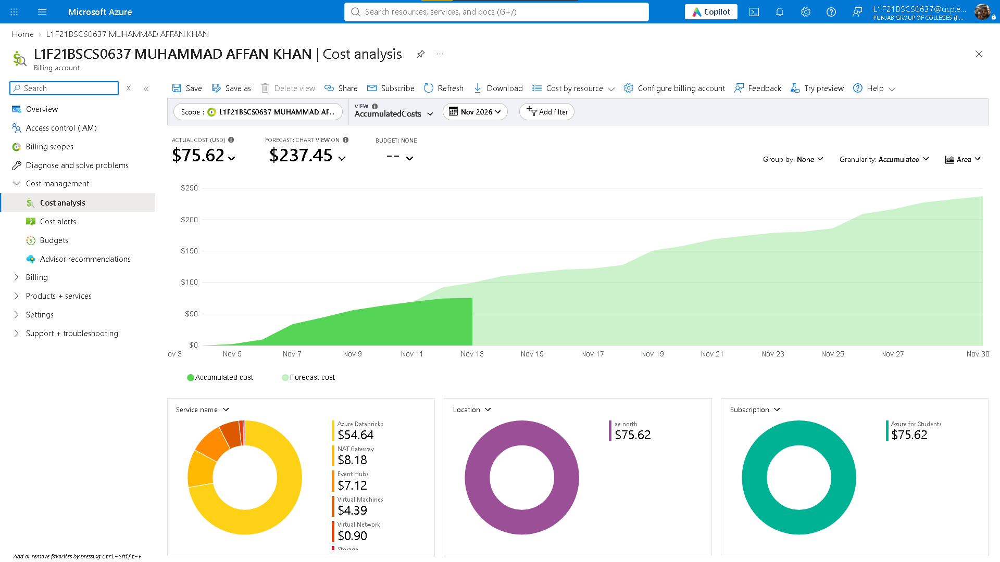
