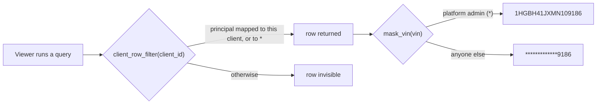

# Security

## 1. Each fleet company sees only its own data

Five data products have a `client_id` column: `vehicle_health`, `driver_safety`,
`fleet_cost_utilization`, `security_misuse` and `platform_billing`. Each carries a Unity
Catalog **row filter**. `vehicle_health` also carries a **column mask** on the VIN.



| Object | Purpose |
|---|---|
| `gold.client_access` | Which principal may see which client: `principal`, `client_id` (`*` for every client), `granted_at`, `granted_by` |
| `gold.client_row_filter(client_id)` | True when the current user is mapped to the row's client, or to `*` |
| `gold.mask_vin(vin)` | The full VIN for platform admins, the last four characters for everyone else |

The filter and mask are attached in the pipeline definitions (`row_filter=` and a `MASK` in
the table schema), so they are part of the table, not of any one dashboard. A direct SQL
query, a notebook and a dashboard all see the same rows.

**Onboarding a fleet manager** is one row:

```sql
INSERT INTO iot_prod.gold.client_access
VALUES ('manager@fleetco.com', 'C004', current_timestamp(), current_user());
```

**Verified:** a user mapped only to `C001` sees C001's six vehicles, with masked VINs, and no
row of any other client.

The SQL is generated by `src/iot/gold/security.py: setup_statements`, which refuses a
principal containing quotes or backslashes, so a principal cannot inject SQL.

## 2. Dashboards run as the viewer

| Dashboard | `embed_credentials` | Effect |
|---|---|---|
| Fleet Operations | `false` | Every query runs as the person viewing it, so row filters and the VIN mask apply to them |
| Platform Health | `true` | Runs as the publisher; only the platform team has access |

Embedding the publisher's credentials in a client-facing dashboard would show every viewer
everything the publisher can see.

## 3. Identities

| Identity | Can | Cannot |
|---|---|---|
| Developer | Everything in `iot_dev`; read-only on `iot_prod` | Change prod |
| `iot-lakehouse-cicd` service principal | All privileges on `iot_prod`; read the Event Hubs secrets; own and run every prod job, pipeline and dashboard | Touch `iot_dev`; create catalogs |
| Fleet manager | See their own client's rows in the data products | See other clients, silver, bronze or operations |
| Platform admin (`*` in `client_access`) | See every client and full VINs | |

### Production is read-only for people

The service principal deploys prod through CI/CD and owns every resource it deploys. The
bundle gives the workspace's `users` group `CAN_VIEW` on all of it, and the setup job grants
the person who runs it `USE CATALOG`, `USE SCHEMA`, `SELECT`, `EXECUTE` and `READ VOLUME` on
the catalog, nothing that writes. A change to prod is a commit, a green CI run and a
deliberate deploy.

Workspace admins can always override permissions in Databricks. In a company, day-to-day work
would use non-admin accounts and the admin account would be break-glass only, with its use
audited. On this single-user subscription the rule is held by practice for the one admin.

## 4. Secrets

| Secret | Where it lives | Who reads it |
|---|---|---|
| Event Hubs **listen** connection string, per environment | Databricks secret scope `iot`: `eventhub-listen-conn-dev`, `eventhub-listen-conn-prod` | The bronze job; the service principal has `READ` on the scope |
| Event Hubs **send** connection string, per environment | Terraform output marked sensitive; an environment variable on the producer's machine | The producer only |
| Service principal OAuth secret | GitHub Actions secret `DATABRICKS_CLIENT_SECRET` | CI/CD only |
| Terraform state and variables | The operator's Cloud Shell, never in git | |

Each hub has two policies: `producer-send` can only send, `databricks-listen` can only
listen. The producer refuses a connection string whose hub does not match `--env`, so dev data
cannot land in prod.

Never committed, enforced by `.gitignore`: `*.tfstate`, `*.tfvars`, `.env`,
`fleet_registry_*.json`, `producer_state_*.json`. `infra/terraform.tfvars.example` holds
placeholders only.

## 5. Storage access

Unity Catalog reaches the storage account through a Databricks access connector, a managed
identity with `Storage Blob Data Contributor` on that account only. No storage keys are used
by Databricks.

## 6. Before the repository is made public

- [x] Rotate the Event Hubs and storage account keys, or destroy the platform, which removes them.
  The platform was destroyed with `terraform destroy`; every key and connection string went with it.
- [x] Remove the Azure subscription ID from the git history. `git filter-repo --replace-text`
  replaced it, and the storage account name, in every commit.
- [x] Scan the full history for secrets. `gitleaks` found no leaks.
- [x] Confirm no resource name is hardcoded in a default; all come from variables, widgets or lookups.
- [x] Turn on branch protection for `main` and required reviewers on the `prod` environment.
  A ruleset blocks force pushes and deletion of `main` and requires a pull request with `lint`
  and `test` passing; `prod` deployments wait for a reviewer's approval.
